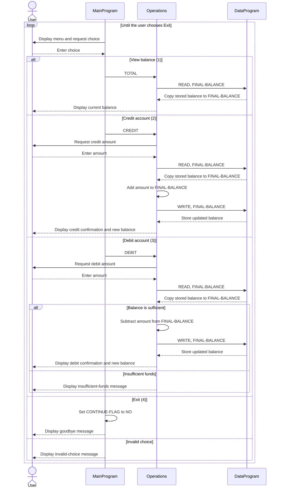

# COBOL Account Management System

This directory documents the COBOL account-management sample in `src/cobol`. The program provides a console menu for viewing and changing a balance. Although this repository is intended for student-account modernization exercises, the current implementation is a generic, single-balance account demo; it does not yet model individual students or student-specific policies.

## Source files

### `main.cob` — `MainProgram`

The command-line entry point. It displays the menu, accepts a numeric choice, and dispatches operations to `Operations`:

- `1` — view the balance (`TOTAL `)
- `2` — credit the account (`CREDIT`)
- `3` — debit the account (`DEBIT `)
- `4` — exit

Other choices display an invalid-choice message and return to the menu. Choosing exit ends the loop and stops the program.

### `operations.cob` — `Operations`

Implements the account actions and interacts with `DataProgram` to read or update the balance.

- **View (`TOTAL `):** reads and displays the current balance.
- **Credit (`CREDIT`):** accepts an amount, reads the balance, adds the amount, writes the result, and displays the new balance.
- **Debit (`DEBIT `):** accepts an amount, reads the balance, and subtracts and writes it only if the balance is at least the requested amount. Otherwise, it displays an insufficient-funds message.

### `data.cob` — `DataProgram`

Provides the balance storage interface. Its procedure accepts an operation and a balance by reference:

- `READ` copies the stored balance to the caller's balance field.
- `WRITE` copies the caller's balance into storage.

The working-storage balance is initialized to `1000.00`. The fields use `PIC 9(6)V99`, representing up to six whole-number digits and two implied decimal places. This is in-memory program storage, not a database or durable student ledger.

## Business rules currently present

- The starting balance is `1000.00`.
- A debit is allowed only when the current balance is greater than or equal to the debit amount; a debit that exceeds the balance is rejected without changing it.
- A credit adds its entered amount to the balance.
- The program does not validate amounts as positive or enforce a maximum balance. Consequently, negative credits/debits and values outside the intended business range are not explicitly prevented.
- The balance is a single shared account value; there is no student lookup or separation between students.

## Student-account scope and limitations

No student-specific business rules are implemented in these files. In particular, there are no student IDs, individual account records, tuition/fee rules, enrollment checks, authorization roles, audit history, or persistent storage. Such policies should be defined and added before this sample is used as a student-account system.

## Application sequence

